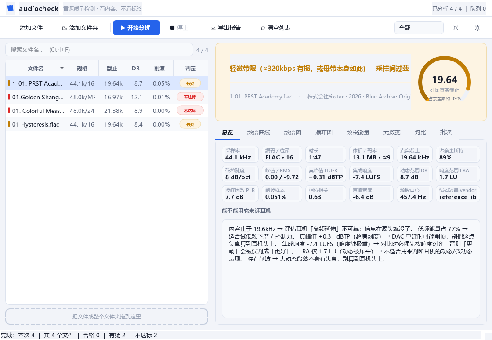

# audiocheck

**看内容，不看标签。**

判断音频文件是「真 Hi-Res」还是「升频糊弄」，量出音乐特性，并把它附带的所有信息摊开。

[](https://github.com/LiaoRanran/audiocheck/actions/workflows/ci.yml)
[](https://www.python.org/)
[](LICENSE)
[](tests/)



---

## 为什么不用现成工具

| 市面常见 | 局限 | audiocheck |
| --- | --- | --- |
| **Spek** | 只画频谱图、不给结论、一次一个文件 | **带等级的判定** + 批量队列 |
| **Fakin' The Funk** | 只测"有损/升频"，收费 | 免费离线，且顺带**音乐特性 + 元数据取证** |
| **MusicScope** | 昂贵、仅 macOS | 跨平台、纯 Python、可自己改 |
| **foobar2000 DR 表** | 只给 DR 一个数 | **EBU R128 响度 / LRA / True Peak** + 带宽 + 频段 + 立体声 |

**五件独有的事**

1. **判定可解释**。同时给出 **真实截止点**、**砖墙陡度**、**容器奈奎斯特**，三者对照才下结论；结论里直接写「砖墙 86dB/oct」这类可验证证据。
2. **元数据取证**。厂牌 / ISRC / 版权 / 注释 / **编码器串**全部摊开——标签能改，但 `vendor` 写着 `reference libFLAC 1.5.0` 还是 `Lavf58.76.100`、注释里留着下载源 URL，这些很难作假。
3. **标准级测量**。不是自创指标：K 加权与门限积分响度严格按 **ITU-R BS.1770-4**（系数按采样率实时重算），LRA 按 **EBU R128 Tech 3342**，真峰值 4 倍过采样。
4. **音乐特性**：七频段能量占比 / DR / 削波 / 立体声宽度与单声道兼容性 / 频谱重心与滚降。
5. **独有的「能不能用它来评耳机」结论**——直接回答这条音源够不够用来测耳机的哪一项。

---

## 安装

```bash
pip install audiocheck                 # 核心（CLI）
pip install "audiocheck[gui]"          # 桌面界面（PySide6 + matplotlib）
pip install "audiocheck[dev]"          # 开发（pytest + ruff）
```

## 使用

```bash
audiocheck "D:/Music/专辑"                     # 分析整个目录
audiocheck a.flac b.flac --json out.json       # 导出 JSON
audiocheck "D:/Music" --csv list.csv --plot 图/ # 导出 CSV + 频谱图
audiocheck --list-analyzers                    # 列出所有分析器（含扩展点）
audiocheck --only spectrum,loudness a.flac     # 只跑部分分析器（调试用）
audiocheck --config my_thresholds.json a.flac  # 自定义判定阈值

audiocheck-gui                                 # 桌面版（可直接拖文件夹进窗口）
python -m audiocheck.summarize out.json 报告.md # 汇总成曲库特性报告
```

Python API：

```python
import audiocheck

r = audiocheck.analyze("song.flac")
print(r["verdict"])      # '伪 Hi-Res（容器 96.0kHz，内容仅到 19.0kHz）｜砖墙 86dB/oct'
print(r["lufs"], r["lra"], r["true_peak_dbfs"])
print(r["meta"]["fields"]["label"])   # 出版商 / 厂牌
```

---

## 测什么

| 层 | 指标 |
| --- | --- |
| **容器** | 采样率 / 位深 / 编码 / 时长 / 声道 / 体积 / 估算码率 / **编码器串 vendor** |
| **标签** | 标题 / 艺术家 / 专辑 / 专辑艺术家 / 日期 / 音轨 / 碟号 / 作曲 / **出版商·厂牌** / **ISRC** / 条码 / 版权 / 编码器 / 注释 / 歌词 / 内嵌封面 |
| **带宽** | 真实截止点、占奈奎斯特比例、砖墙陡度 (dB/oct) |
| **响度** | **集成响度 LUFS**、**响度范围 LRA**、**真峰值 dBTP**、PLR、短时极值、DR、波峰因数 |
| **电平** | 峰值 / RMS / 削波样本比例 / 直流偏移 |
| **频谱** | 频谱重心、85% & 95% 滚降点、谱平坦度、噪声底 |
| **立体声** | 相位相关、声道宽度 (M/S 能量比)、单声道兼容性、L/R 电平差 |
| **频段** | 超低 20–60 / 低频 60–250 / 中低 250–500 / 中频 500–2k / 中高 2–6k / 高频 6–16k / 空气 16–20k（Hz） |

## 判定口径（为什么不是"看截止点就完事"）

**同一个截止点，在不同容器里含义完全不同**——这是市面工具最容易出错的地方：

| 容器 | 真实截止 | 判定 |
| --- | --- | --- |
| 44.1 kHz | ≥ 21.5k | CD 级满带宽 ✅ |
| 44.1 kHz | 19–21.5k | 轻微带限（≈320kbps 有损，或母带本身如此）⚠️ |
| 44.1 kHz | 16–19k | 有损溯源（≈192–256kbps 转码）❌ |
| 48 kHz | ≥ 23k | 真 48kHz 带宽 ✅ |
| 48 kHz | **21–23k** | **疑似 44.1kHz 升频**（内容顶在 22.05k 上限）❌ |
| 96 / 192 kHz | **≤ 24.5k** | **伪 Hi-Res**（容器提了，信息量没提）❌ |
| 96 / 192 kHz | ≥ 85% 奈奎斯特 | 真 Hi-Res ✅ |

追加的响度类标记（不改变带宽结论，但影响"能不能拿它评耳机"）：

- 真峰值 **> 0 dBTP** → `采样间过载`：DAC 重建时会削顶
- 集成响度 **> −9 LUFS** → `响度战`：对比时必须先对齐响度
- LRA **< 3 LU** → `动态压平`：不能用来判断耳机的动态表现

---

## 桌面版

无边框窗口 + 侧边栏导航 + 设计系统（间距/圆角/字阶/语义色全部令牌化，暗亮双主题）。

**8 个视图**：总览（环形仪表 + 18 项指标卡 + 建议）｜频谱曲线（悬停十字读数）｜频谱图｜**3D 瀑布图（可拖拽旋转）**｜频段能量｜**元数据**（容器标签 + 全部指标）｜多文件对比｜批次分布

**交互**：拖文件夹进来即分析 · 搜索过滤 · 按结论筛选 · 待分析项灰色占位 · **命令面板 `Ctrl+K`**（模糊搜索所有操作）· 右下角 Toast 通知 · 无选中时给空状态而不是死界面 · 窗口几何与主题记忆 · 高 DPI 适配

**快捷键**：`Ctrl+K` 命令面板 ｜ `Ctrl+O` 加文件 ｜ `Ctrl+Shift+O` 加文件夹 ｜ `F5` 开始 ｜ `Esc` 停止 ｜ `Ctrl+E` 导出 ｜ `Ctrl+L` 清空 ｜ `Delete` 移除 ｜ `Ctrl+F` 搜索 ｜ `Ctrl+T` 阈值 ｜ `Ctrl+D` 主题

**导出**：HTML 报告 / JSON / CSV / 当前视图 PNG

---

## 性能

批量分析走 `core/pipeline.py`：**多进程并行 + 结果缓存**。

实测（12 个 FLAC，16 核机器）：

| 模式 | 耗时 | 单文件 |
| --- | --- | --- |
| 串行 | 44.1s | 3.67s |
| `--jobs 4` | 15.8s | 1.31s |
| `--jobs 8` | **13.3s** | 1.10s |
| 命中缓存 | **0.000s** | — |

缓存键 = 路径 + 大小 + 修改时间；文件被替换或重编码后自动失效。
文件数 < 4 时自动退回串行（Windows/macOS 的 spawn 启动开销大于收益）。

```bash
audiocheck "D:/Music" --jobs 8 --cache .ac_cache.json
```

---

## 架构与扩展

```
src/audiocheck/
├── config.py            阈值与频段定义（所有"魔法数字"的唯一出处）
├── cli.py               命令行入口（含 doctor 自检）
├── summarize.py         批量结果 → 曲库特性报告
├── core/                分析引擎（纯计算，不依赖 Qt）
│   ├── registry.py      分析器注册表  ← 扩展点
│   ├── context.py       共享上下文（缓存频谱/解码片段）
│   ├── metrics.py       指标元信息（标签/单位/小数位/分组）
│   ├── dsp.py           BS.1770 / R128 标准原语
│   ├── views.py         频谱图/瀑布图数据
│   ├── pipeline.py      多进程并行 + 结果缓存 + 进度 ETA
│   ├── engine.py        调度与结果组装
│   └── analyzers/       各分析器，**自动发现**
└── ui/                  Qt 界面（可选依赖，懒加载）
    ├── theme.py         设计令牌 → QSS（唯一的视觉参数出处）
    ├── chrome.py        无边框窗口 + 自绘标题栏 + 系统级缩放
    ├── widgets.py       侧边栏 / 命令面板 / Toast / 空状态 / 仪表
    ├── charts.py        6 个 matplotlib 画布 + 表格绘制委托
    └── window.py        主窗口（信息架构与交互）
```

**测量原理见 [`docs/theory.md`](docs/theory.md)**：每个数字的定义、标准出处、
误差边界，以及**哪些数字能当证据、哪些只是线索**。

**加一个新指标 = 在 `core/analyzers/` 新建一个文件**，挂上 `@register`，其余全部自动生效
（引擎调度、JSON 导出、GUI 指标卡、CSV 列）：

```python
# src/audiocheck/core/analyzers/polarity.py
from ..registry import Analyzer, register
import numpy as np

@register
class PolarityAnalyzer(Analyzer):
    key = "polarity"
    label = "极性 / 声道相位"
    order = 45                     # 越大越晚跑
    requires = ("stereo",)         # 声明依赖，引擎按拓扑序调度

    def run(self, ctx) -> dict:
        seg, fs = ctx.segment(seconds=30)
        if seg is None or ctx.channels < 2:
            return {}
        inverted = float(np.corrcoef(seg[:, 0], seg[:, 1])[0, 1]) < -0.5
        ctx.metric("polarity_inverted", "疑似极性反接", group="立体声", primary=True)
        return {"polarity_inverted": bool(inverted)}
```

详见 [`docs/architecture.md`](docs/architecture.md)（含**截止点检测三代演进**的完整踩坑记录）。

---

## 测试

69 个用例，**全部基于合成音频**，可离线跑、可回归：

```bash
pytest -q                 # 约 25 秒
pytest --cov=audiocheck
```

策略：
- 截止点用「白噪声 + FFT 砖墙」——频谱平坦，截止点就是标准答案（实测误差 <1%）；
- 响度用「同一正弦、幅度减半」验证 **6.02 LU 标度不变性**（比断言绝对值稳）；
- 缓滚降用 2 阶巴特沃斯，专门验证「不被误判为截止」。

---

## 已知限制

- **截止点贴近奈奎斯特时（相差 <10%）分辨率下降**：1/3 倍频程里放不下明显落差。
  已用「顶部 5% 频段落差」做兜底，但极端情况仍可能把 48k 容器里 22.05k 的升频判成"真 48kHz"。
- **不能检测 MQA / HDCD 等编码层信息**（需要解码器支持，不在本项目范围）。
- **响度是整体值**，不提供分段响度曲线。
- 元数据依赖 `mutagen`；无标签文件会如实显示"无标签信息"，**不会推测**。

## 许可

[MIT](LICENSE)。欢迎提交 Issue 与 PR，见 [CONTRIBUTING.md](CONTRIBUTING.md)。
